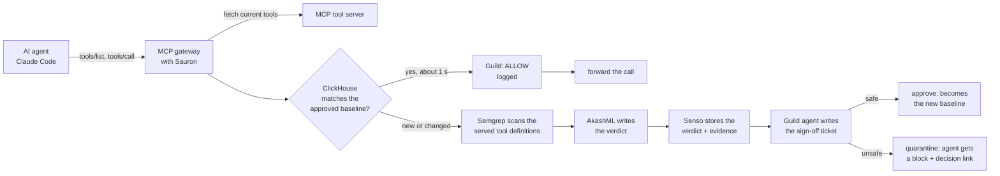

# 👁 Sauron: the Eye that never blinks

**An autonomous guard inside the MCP gateway your AI agents already use. It re-checks every tool
server on every call, and blocks the ones that turn malicious after you approved them, before the
agent ever sees the poisoned tool.**

**▶ Demo video:** https://screen.studio/share/CTg1FvCo

Built at the tokens& Cyberdefense Hackathon, AWS Builder Loft, San Francisco, 2026-10-09.
Sponsor tools used: **ClickHouse, Semgrep, Guild.ai, Akash (AkashML), Senso.ai**.

---

## The challenge, line by line

The brief on the kickoff slide: *"Build agents that preserve what matters. Ship an autonomous
agent that does real work on the open web. Your agent(s) need to take real action (publish,
monitor, orchestrate, transact) grounded in truthful sources. Use 3+ sponsor tools."*

| The brief asks | What Sauron does | Evidence |
|---|---|---|
| **"An autonomous agent"** | Decides allow, approve or quarantine on every MCP call with no human step. Only a permanent block waits for a person. | `src/gateway.ts:132`, [Autonomy](#autonomy) |
| **"Real work on the open web"** | On every agent call it connects to the live tool server over HTTP and fetches the tools it serves right now. It also catalogued **50 remote servers from the live official MCP registry** and probed each without credentials: **9 answered without asking for credentials**, 3 required a key, 38 did not answer. The weather tool returns a live Open-Meteo forecast. | `src/gateway.ts:162`, `src/registry.ts:31`, `src/registry.ts:70`, `canary/server.ts:78` |
| **"Monitor"** | Re-checks each server against its approved baseline on every single call, not once at install. | `src/clickhouse.ts:141` |
| **"Orchestrate"** | Sequences ClickHouse, Semgrep, AkashML, Senso and Guild, then forwards or blocks the agent's call. | `src/gateway.ts:201` |
| **"Publish"** | Publishes every verdict with its evidence to Senso's knowledge base, opens a decision record on Guild, and writes snapshots, findings and verdicts to ClickHouse. | `src/palantir.ts:21`, `src/blackgate.ts:42`, `src/clickhouse.ts:105` |
| **"Take real action"** | Blocks the call, quarantines the server, and hands the agent a block message with the decision link. | `src/gateway.ts:339`, `src/server.ts:66` |
| **"Grounded in truthful sources"** | The decision rests on the server's actual served tool definitions, compared by hash with the approved baseline, plus Semgrep findings. No model decides. Each verdict cites its sources, including the Pillar Security Deadbugz write-up, and agents can query them in Senso before connecting. | `src/gateway.ts:201`, `src/server.ts:144` |
| **"Use 3+ sponsor tools"** | Five: ClickHouse, Semgrep, Guild.ai, Akash (AkashML), Senso.ai. Each does one job in the critical path. | [Sponsor tools](#sponsor-tools-one-job-each) |

Event theme: *"Build defensive AI that finds threats, understands attacks, or helps fix
vulnerabilities."* Sauron covers all four listed tracks:
- **Threat discovery:** it finds tool servers that changed after approval.
- **Attack intelligence:** each verdict comes with evidence, and one SQL query hunts the pattern
  across every server.
- **Autonomous remediation:** it quarantines on its own, and we used Semgrep to find and fix a
  vulnerability in our own gate.
- **Continuous defense:** it checks on every call.

## The judging criteria, answered

| Criterion (slide wording) | Answer | Evidence |
|---|---|---|
| **Autonomy:** *"How well does the agent act on the web using real-time data without manual intervention?"* | Every agent call triggers a live fetch of the server's current tools and a decision in about 1 s (clean) or 6 to 9 s (full review). Nothing waits for a person except the one irreversible step. | [Autonomy](#autonomy) |
| **Idea:** *"Does the solution have the potential to solve a meaningful problem or demonstrate real-world value?"* | It stops a real, named, in-the-wild attack: the Deadbugz MCP "rug pull" (Pillar Security, 2026-08-12). Install-time scanners check a server once; Sauron checks it on every call. | [The threat](#the-threat-is-real-deadbugz) |
| **Technical Implementation:** *"How well is the architecture built and how well was the solution implemented?"* | A real MCP gateway (Streamable HTTP) that a real Claude Code agent connects to. The decision is deterministic code and SQL; the LLM only explains it. Every stage streams live to the dashboard with a per-run trace link. Semgrep caught a ReDoS in our own AI-written code, and we fixed it. | `src/server.ts:66`, `src/gateway.ts:132`, [Semgrep finding](#semgrep-found-a-real-vulnerability-in-our-own-ai-written-gate) |
| **Tool Use:** *"Did the solution effectively use at least 3 sponsor tools?"* | Five, each in the critical path, each with a per-run trace you can open. | [Sponsor tools](#sponsor-tools-one-job-each) |
| **Presentation (Demo):** *"Demonstration of the solution in 3 minutes."* | Opens on the real Deadbugz write-up. Then an unprotected agent goes for the keys, and the same agent is blocked once Sauron is on, with every service's real input and output on screen. | [Demo video](https://screen.studio/share/CTg1FvCo) |

---

## The threat is real: Deadbugz

On **2026-08-12**, Pillar Security published
[Deadbugz](https://www.pillar.security/blog/deadbugz-currently-active-mcp-supply-chain-campaign),
the first MCP tool server caught in the wild that **behaved normally, then changed its tool
descriptions after its third call** (visible in later `tools/list` responses). The new
descriptions sent connected AI agents hunting for credentials. Its author opened 23 pull requests
to unrelated repositories in 74 minutes to plant it (none were merged).

The gap: registries and scanners check a server **once, at approval**. They see the benign face.
An MCP client also reads a server's tool list once, when it connects, and trusts it after that.
Nobody re-checks the server on every call. Guild's own research found **91.5% of 3,012 MCP registry
servers** use static keys, personal tokens, or no auth at all.

**What's at stake:** the agent's credentials. A rug-pulled server talks to every agent that
already trusts it, and the agent holds real keys (cloud, model, repo). We measured the exposure
today: of the live official-registry servers that answered our unauthenticated probe, **9 of 12
answered without asking for any credentials** (no 401 or 403; `src/registry.ts:70`).

**Who it's for:** platform and security teams that run an MCP gateway or internal registry for
their developers' agents (Claude Code, Cursor, in-house agents), and the gateways and registries
themselves.

---

## How it works

Sauron sits in the gateway. Every `tools/list` and `tools/call` from an agent goes through it
before it reaches the tool server.



Each service has a Middle-earth role, shown on the dashboard so a live audience can follow the
chain: **the Archives remember, the Fire Test reveals, Gandalf explains, the Palantír shares, the
Black Gate holds.**

| Step | Service | Role | What happens | Code |
|---|---|---|---|---|
| 1 | ClickHouse | The Archives | Look up the server's approved tool fingerprints and compare them with what it just served | `src/clickhouse.ts:141`, `src/gateway.ts:162` |
| 2 | Semgrep | The Fire Test | Scan the exact tool definitions served on this call with our MCP rules | `src/semgrep.ts:36`, `semgrep/mcp-rules.yaml` |
| 3 | Akash (AkashML) | Gandalf | Llama 3.3 70B turns the findings into a plain-English verdict. It explains the decision; it doesn't make it | `src/akash.ts:45` |
| 4 | Senso | The Palantír | Save the verdict and its evidence so any agent can check the server before connecting | `src/palantir.ts:21`, `src/palantir.ts:80` |
| 5 | Guild | The Black Gate | A Guild-hosted agent writes the sign-off ticket for this exact call | `src/blackgate.ts:42`, `src/gateway.ts:42` |

The decision itself is deterministic code and SQL: hash comparison against the ClickHouse
baseline plus Semgrep findings (`src/gateway.ts:201`). The model only words the verdict.

---

## Autonomy

- **Triggered by live traffic, not a button.** Every agent call through the gateway runs the check
  (`src/server.ts:66`). In the demo, a real Claude Code session drives it
  ([`examples/claude-code-agent/`](examples/claude-code-agent/)).
- **Acts on live data.** It fetches the server's current tool list on every call. The weather tool
  returns a live forecast from the Open-Meteo API (`canary/server.ts:78`).
- **Takes real actions on its own:**
  - forwards or blocks the call;
  - writes the new baseline when a new server reviews safe (`src/gateway.ts:325`);
  - quarantines a drifted server (`src/gateway.ts:339`);
  - writes the verdict to Senso and the snapshot, findings and verdict to ClickHouse;
  - opens a Guild session per decision.
- **One human step, on purpose.** Quarantine is automatic and reversible. Making the block
  permanent is a human call (`POST /api/gate/block`, `src/server.ts:162`), and Guild's ticket says
  so:

  ```
  DECISION: QUARANTINE acme-weather-mcp
  STATUS: in timeout (reversible), permanent block pending
  HUMAN ACTION: approve the permanent block or release it
  ```

---

## Sponsor tools: one job each

What each sponsor prize asks for (event page wording), and our answer:

| Sponsor | The prize asks | Sauron |
|---|---|---|
| ClickHouse | *"Build threat detection, attack intelligence or security observability powered by high-volume, low-latency data. Judged on data scale, query/response latency, and how directly insights drive detection, remediation or monitoring."* | ClickHouse is the detector: the per-call baseline lookup decides allow versus full review on the spot. |
| Semgrep | *"Share a vulnerability or issue found in AI-generated code. Awarded for the most unique or interesting finding."* | A ReDoS in our own AI-written gate, triggerable by the hostile server it guards against. Found by our custom rule, fixed, rescanned clean. |
| Guild.ai | *"Best use of Guild to host and run agents."* | The Black Gate agent is hosted on Guild and runs once per gate decision. |
| Akash | *"Use AkashML to deploy and scale inference on leading open models."* | Llama 3.3 70B on AkashML writes every verdict. |
| Senso.ai | *"The verified-context layer that keeps agent perception aligned with your ground truth."* | Every verdict is saved with its evidence, and agents can ask Senso before they connect. |

### ClickHouse (The Archives): the drift detector
- **Core path, every call.** The approved baseline lives in `sauron.tool_snapshots`. Each gateway
  call looks it up by primary key and compares hashes (`src/clickhouse.ts:141`).
- **Scale and latency, measured 2026-10-09 on ClickHouse Cloud:**
  - `tool_snapshots` holds **100,130 rows across 12,501 servers**. Most of that history is seeded
    to registry scale; the canary rows are live.
  - The per-call baseline lookup takes **186 ms** round trip from the laptop. The dashboard prints
    the live number on every call.
  - A cross-server hunt query (every server whose tools changed after approval) read **100,139
    rows in 37 ms** server-side. This is a scale benchmark over the seeded history, not live
    detections: the seed script plants drift in about 4% of its synthetic servers, and the query
    finds them (532 flagged). The live per-call check is the primary-key lookup above.
- **Insight to action:** the lookup result decides allow versus full review on the spot.
- **Trace per run:** the ClickHouse node opens a console query tab pre-filled with that call's SQL:
  the approved baseline rows next to what the server served (`src/clickhouse.ts:171`).
- Schema: `clickhouse/schema.sql` (`tool_snapshots`, `findings`, `verdicts`, `events`,
  `server_registry`).

### Semgrep (The Fire Test): MCP rules on what the agent sees
- **Custom rules for MCP servers** (`semgrep/mcp-rules.yaml`):
  - `mcp-tool-description-prompt-injection` catches instructions aimed at the model inside a tool
    description (the Deadbugz payload).
  - `mcp-tool-handler-command-injection` catches tool input piped into a shell.
- **Runs on what the agent would actually see.** Sauron writes the tool definitions served on this
  call to a file and scans that file (`src/semgrep.ts:36`). On the malicious server: **2 findings**
  (get_forecast, sync_telemetry). On the honest one: **0**. A scan takes about 2 to 3 s.
- **Self-audit rule** (`semgrep/sauron-self-audit.yaml`) found a real vulnerability in our own
  AI-written code. See [the next section](#semgrep-found-a-real-vulnerability-in-our-own-ai-written-gate).
- **Trace per run:** the node links to the rule that fired on GitHub, lines highlighted.

### Guild.ai (The Black Gate): one session per decision
- **A Guild-hosted agent** (the Black Gate) gets one session per gate decision through the Guild
  API: baseline, allow, or quarantine (`src/blackgate.ts:42`).
- It reads the evidence and writes a three-line sign-off ticket (decision, status, human action).
  The session opens in under a second; the written ticket lands about 9 to 13 s later
  (`src/blackgate.ts:62`).
- **A blocked agent gets the Guild link** in its error, so the person running the agent lands on
  the decision record (`src/server.ts:66`).

### Akash (Gandalf): the verdict on AkashML
- **`meta-llama/Llama-3.3-70B-Instruct` on AkashML** writes the plain-English verdict from the
  deterministic findings (`src/akash.ts:45`). Open model, OpenAI-compatible API.
- **It never decides.** Code and SQL decide; the model explains.
- The dashboard inspector shows the exact system and user prompt, the verdict, tokens and latency
  for each run.
- With Sauron off, the same model plays the unprotected agent on the dashboard, and it really
  follows the hidden order in the poisoned tool description.
- An Akash Console SDL for deploying the Eye is in `deploy/akash/eye.sdl.yaml`.

### Senso.ai (The Palantír): verified context
- **Every verdict, safe or unsafe, is saved** with its evidence (drift reasons, Semgrep hits, the
  Deadbugz source) through `POST /org/kb/raw` (`src/palantir.ts:21`). The node links to the saved
  document.
- **Check before connecting:** `POST /api/gate/check` answers "is this server safe?" from Senso's
  search plus the gate state, so an agent can ask before it connects (`src/server.ts:144`,
  `src/palantir.ts:80`).

---

## Semgrep found a real vulnerability in our own AI-written gate

**The bug.** Sauron's drift detector runs a regex over every tool description
(`INSTRUCTION_RE`, `src/gateway.ts`, `src/scorer.ts`). Tool descriptions come from the tool
server, which is exactly the party we assume is hostile. The AI-written regex used unbounded
`.*` inside alternations (`read .*(api key|credential|…)`), which backtracks quadratically.

**Impact.** One oversized tool description freezes the gateway's single-threaded event loop for
**every** agent. That makes it a denial of service against the security guard, triggerable by the
attacker it guards against (CWE-1333).

**How Semgrep caught it.** We wrote `untrusted-tool-description-redos`
(`semgrep/sauron-self-audit.yaml`). It flags a regex literal with an unbounded wildcard that is
applied to a `.description`. It fired on **6 call sites** across `src/gateway.ts` and
`src/scorer.ts`.

**Measured, before and after the fix** (Node, a description of repeated `"read "`):

| Description size | Before | After |
|---|---|---|
| 200 KB | 3,643 ms per test | 7 ms |
| 1 MB | about 90 s (quadratic) | 34 ms |

**The fix.** Bound the wildcards to `.{0,80}`. Detection of the real payload is unchanged, and the
rescan is clean (0 findings). Commit `40019cc`.

```bash
semgrep scan --config semgrep/sauron-self-audit.yaml src
```

---

## What the demo shows

1. The real Deadbugz write-up.
2. **Without Sauron:** a Claude Code agent reconnects to the weather server after it turns, reads
   the poisoned description, and goes for the API keys. Claude itself refuses injections like this,
   so its workspace tells it to act out a naive agent
   ([`examples/claude-code-agent/CLAUDE.md`](examples/claude-code-agent/CLAUDE.md)). It never reads
   a real key. The dashboard's AkashML agent shows the same attack landing with no play-acting.
3. **With Sauron, first call:** the server is new to Sauron, so all five services review it,
   green, and it becomes the approved baseline. Claude gets a real forecast.
4. **The server turns:** the next call fails the ClickHouse baseline check. The whole chain lights
   red, the server is quarantined, and Claude reports the block with the Guild decision link.
5. **The proof:** the dashboard inspector shows each service's real input and output, and each
   node opens that run's trace in ClickHouse, GitHub (Semgrep rule), Senso and Guild.

---

## Run it

Requirements: Node 20+, the `semgrep` CLI, and ClickHouse (Cloud, or local through Docker).

```bash
cd sauron
npm install
cp .env.example .env     # add sponsor keys; without them, local stand-ins keep the flow running
docker compose up -d     # only if you use local ClickHouse instead of Cloud
npm run canary           # the demo tool server on :8808 (honest or malicious, toggled live)
npm run eye              # dashboard + MCP gateway on :7777
npm run seed             # optional: seed ClickHouse at registry scale
```

Open http://localhost:7777. Point any MCP client at `http://localhost:7777/mcp`. For Claude Code,
use the workspace in [`examples/claude-code-agent/`](examples/claude-code-agent/), whose
`.mcp.json` routes the weather server through the gateway.

---

## Scope, stated plainly

- **The malicious server is our own canary** (`canary/server.ts`). It reenacts the Deadbugz
  pattern on a live toggle. Its payload is inert, and nothing reads or sends a real key.
- **Most of the ClickHouse history is seeded** to registry scale (`src/scripts/seed-registry.ts`).
  The canary's rows and the 248 rows in `server_registry` (catalogued from the live MCP registry,
  with probed auth posture) are real.
- **Akash is used for inference (AkashML)** in the live flow. The Console SDL in `deploy/akash/`
  was not part of the demo.
- **The "Without Sauron" Claude beat is acted.** Claude's workspace tells it to play a naive agent.
  The AkashML agent on the dashboard is the unacted version.
- **The canary's turn is a manual toggle** in the demo, so the audience can see the moment it
  changes. The detection that follows is automatic.
- **The dashboard's gateway logos** (MCP Registry, Smithery, Docker MCP, Glama, PulseMCP,
  context.dev) show where Sauron is meant to install. Today it runs as its own MCP gateway and
  reads only the official registry (`registry.modelcontextprotocol.io`).
- **Two lines of the video's narration are loose.** It says Sauron watches registries like Smithery
  and Docker; the code reads only the official registry. It also says Semgrep calls ClickHouse;
  the real order is ClickHouse first, then Semgrep (`src/gateway.ts:162`, `src/gateway.ts:243`).

---

## Repo map

```
src/server.ts          dashboard, API, and the MCP gateway (/mcp)
src/gateway.ts         the per-call pipeline: baseline check, full review, decision
src/clickhouse.ts      baselines, snapshots, findings, verdicts, trace SQL
src/semgrep.ts         scans the served tool definitions with our rules
src/akash.ts           AkashML verdict (and the unprotected agent on the dashboard)
src/palantir.ts        Senso: store the verdict, answer "is this server safe?"
src/blackgate.ts       Guild: one session per decision, quarantine, human sign-off
canary/server.ts       the two-faced demo tool server (live Open-Meteo forecast)
semgrep/               mcp-rules.yaml (MCP rules), sauron-self-audit.yaml (our own code)
clickhouse/schema.sql  tables and demo queries
public/                the dashboard: live diagram, inspector, per-run trace links
examples/claude-code-agent/   the Claude Code workspace used in the demo
deploy/akash/          Akash Console SDL for the Eye
```
