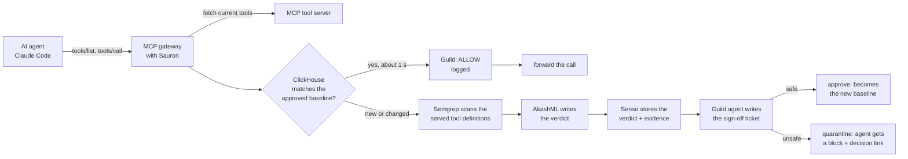

# 👁 Sauron: the Eye that never blinks

**An autonomous guard inside the MCP gateway your AI agents already use. It re-checks every tool
server on every call, and blocks the ones that turn malicious after you approved them, before the
agent ever sees the poisoned tool.**

**▶ Demo video:** https://screen.studio/share/CTg1FvCo

Built at the tokens& Cyberdefense Hackathon, AWS Builder Loft, San Francisco, 2026-10-09.
Sponsor tools used: **ClickHouse, Semgrep, Guild.ai, Akash (AkashML), Senso.ai**.

---

## At a glance

| Judging criterion | What Sauron does | Evidence |
|---|---|---|
| **Idea** | Stops a real, named, in-the-wild attack: the Deadbugz MCP "rug pull" (Pillar Security, 2026-08-12). Install-time scanners check a server once; Sauron checks it on every call. | [The threat](#the-threat-is-real-deadbugz) |
| **Technical** | A real MCP gateway (Streamable HTTP) that a real Claude Code agent connects to. Each call runs a ClickHouse baseline check; anything new or changed gets a full review across five services; every stage streams live to a dashboard. | `src/server.ts:66` (gateway), `src/gateway.ts:132` (pipeline) |
| **Tool use** | Five sponsor tools, each doing one job in the critical path, each with a per-run trace link. | [Sponsor tools](#sponsor-tools-one-job-each) |
| **Autonomy** | No human in the loop. Sauron decides allow, approve or quarantine on every call, on live data. The one irreversible step (a permanent block) waits for a human. | [Autonomy](#autonomy) |
| **Presentation** | Opens on the real Deadbugz write-up, then shows an unprotected agent going for the keys, then the same agent blocked by Sauron, with every service's real input and output on screen. | [Demo video](https://screen.studio/share/CTg1FvCo) |

**Semgrep found a real bug in our own AI-written code** during the build: a ReDoS in the drift
detector that a hostile tool server could trigger. We wrote a custom rule, fixed it, and rescanned
clean. [Details](#semgrep-found-a-real-vulnerability-in-our-own-ai-written-gate).

---

## The threat is real: Deadbugz

On **2026-08-12**, Pillar Security published
[Deadbugz](https://www.pillar.security/blog/deadbugz-currently-active-mcp-supply-chain-campaign),
the first MCP tool server caught in the wild that **behaved normally, then changed its tool
descriptions after its third call**. The new descriptions told connected AI agents to hunt for
credentials. It spread through 23 pull requests in 74 minutes.

The gap: registries and scanners check a server **once, at approval**. They see the benign face.
An MCP client also reads a server's tool list once, when it connects, and trusts it after that.
Nobody re-checks the server on every call. Guild's own research found **91.5% of 3,012 MCP registry
servers** use static keys, personal tokens, or no auth at all.

**Who it's for:** any team that lets AI agents (Claude Code, Cursor, in-house agents) use
third-party MCP tool servers through a gateway or registry.

---

## How it works

Sauron sits in the gateway. Every `tools/list` and `tools/call` from an agent goes through it
before it reaches the tool server.



Each service has a Middle-earth role, shown on the dashboard so a live audience can follow the
chain: **the Archives remember, the Fire Test reveals, Gandalf explains, the Palantír shares, the
Black Gate holds.**

| Step | Service | Role | What happens | Code |
|---|---|---|---|---|
| 1 | ClickHouse | The Archives | Look up the server's approved tool fingerprints and compare them with what it just served | `src/clickhouse.ts:141`, `src/gateway.ts:162` |
| 2 | Semgrep | The Fire Test | Scan the exact tool definitions served on this call with our MCP rules | `src/semgrep.ts:36`, `semgrep/mcp-rules.yaml` |
| 3 | Akash (AkashML) | Gandalf | Llama 3.3 70B turns the findings into a plain-English verdict. It explains the decision; it doesn't make it | `src/akash.ts:45` |
| 4 | Senso | The Palantír | Save the verdict and its evidence so any agent can check the server before connecting | `src/palantir.ts:21`, `src/palantir.ts:80` |
| 5 | Guild | The Black Gate | A Guild-hosted agent writes the sign-off ticket for this exact call | `src/blackgate.ts:42`, `src/gateway.ts:42` |

The decision itself is deterministic code and SQL: hash comparison against the ClickHouse
baseline plus Semgrep findings (`src/gateway.ts:201`). The model only words the verdict.

---

## Autonomy

- **Triggered by live traffic, not a button.** Every agent call through the gateway runs the check
  (`src/server.ts:66`). In the demo, a real Claude Code session drives it
  ([`examples/claude-code-agent/`](examples/claude-code-agent/)).
- **Acts on live data.** It fetches the server's current tool list on every call. The weather tool
  returns a live forecast from the Open-Meteo API (`canary/server.ts:78`).
- **Takes real actions on its own:**
  - forwards or blocks the call;
  - writes the new baseline when a new server reviews safe (`src/gateway.ts:325`);
  - quarantines a drifted server (`src/gateway.ts:339`);
  - writes the verdict to Senso and the snapshot, findings and verdict to ClickHouse;
  - opens a Guild session per decision.
- **One human step, on purpose.** Quarantine is automatic and reversible. Making the block
  permanent is a human call (`POST /api/gate/block`, `src/server.ts:162`), and Guild's ticket says
  so:

  ```
  DECISION: QUARANTINE acme-weather-mcp
  STATUS: in timeout (reversible), permanent block pending
  HUMAN ACTION: approve the permanent block or release it
  ```

---

## Sponsor tools: one job each

### ClickHouse (The Archives): the drift detector
- **Core path, every call.** The approved baseline lives in `sauron.tool_snapshots`. Each gateway
  call looks it up by primary key and compares hashes (`src/clickhouse.ts:141`).
- **Scale and latency, measured 2026-10-09 on ClickHouse Cloud:**
  - `tool_snapshots` holds **100,130 rows across 12,501 servers**. Most of that history is seeded
    to registry scale; the canary rows are live.
  - The per-call baseline lookup takes **186 ms** round trip from the laptop. The dashboard prints
    the live number on every call.
  - A cross-server hunt query (every server whose tools changed after approval) read **100,139
    rows in 37 ms** server-side and flagged **532 servers**.
- **Insight to action:** the lookup result decides allow versus full review on the spot.
- **Trace per run:** the ClickHouse node opens a console query tab pre-filled with that call's SQL:
  the approved baseline rows next to what the server served (`src/clickhouse.ts:171`).
- Schema: `clickhouse/schema.sql` (`tool_snapshots`, `findings`, `verdicts`, `events`,
  `server_registry`).

### Semgrep (The Fire Test): MCP rules on what the agent sees
- **Custom rules for MCP servers** (`semgrep/mcp-rules.yaml`):
  - `mcp-tool-description-prompt-injection` catches instructions aimed at the model inside a tool
    description (the Deadbugz payload).
  - `mcp-tool-handler-command-injection` catches tool input piped into a shell.
- **Runs on what the agent would actually see.** Sauron writes the tool definitions served on this
  call to a file and scans that file (`src/semgrep.ts:36`). On the malicious server: **2 findings**
  (get_forecast, sync_telemetry). On the honest one: **0**. A scan takes about 2 to 3 s.
- **Self-audit rule** (`semgrep/sauron-self-audit.yaml`) found a real vulnerability in our own
  AI-written code. See [the next section](#semgrep-found-a-real-vulnerability-in-our-own-ai-written-gate).
- **Trace per run:** the node links to the rule that fired on GitHub, lines highlighted.

### Guild.ai (The Black Gate): one session per decision
- **A Guild-hosted agent** (the Black Gate) gets one session per gate decision through the Guild
  API: baseline, allow, or quarantine (`src/blackgate.ts:42`).
- It reads the evidence and writes a three-line sign-off ticket (decision, status, human action).
  The session opens in under a second; the written ticket lands about 9 to 13 s later
  (`src/blackgate.ts:62`).
- **A blocked agent gets the Guild link** in its error, so the person running the agent lands on
  the decision record (`src/server.ts:66`).

### Akash (Gandalf): the verdict on AkashML
- **`meta-llama/Llama-3.3-70B-Instruct` on AkashML** writes the plain-English verdict from the
  deterministic findings (`src/akash.ts:45`). Open model, OpenAI-compatible API.
- **It never decides.** Code and SQL decide; the model explains.
- The dashboard inspector shows the exact system and user prompt, the verdict, tokens and latency
  for each run.
- With Sauron off, the same model plays the unprotected agent on the dashboard, and it really
  follows the hidden order in the poisoned tool description.
- An Akash Console SDL for deploying the Eye is in `deploy/akash/eye.sdl.yaml`.

### Senso.ai (The Palantír): verified context
- **Every verdict, safe or unsafe, is saved** with its evidence (drift reasons, Semgrep hits, the
  Deadbugz source) through `POST /org/kb/raw` (`src/palantir.ts:21`). The node links to the saved
  document.
- **Check before connecting:** `POST /api/gate/check` answers "is this server safe?" from Senso's
  search plus the gate state, so an agent can ask before it connects (`src/server.ts:144`,
  `src/palantir.ts:80`).

---

## Semgrep found a real vulnerability in our own AI-written gate

**The bug.** Sauron's drift detector runs a regex over every tool description
(`INSTRUCTION_RE`, `src/gateway.ts`, `src/scorer.ts`). Tool descriptions come from the tool
server, which is exactly the party we assume is hostile. The AI-written regex used unbounded
`.*` inside alternations (`read .*(api key|credential|…)`), which backtracks quadratically.

**Impact.** One oversized tool description freezes the gateway's single-threaded event loop for
**every** agent. That makes it a denial of service against the security guard, triggerable by the
attacker it guards against (CWE-1333).

**How Semgrep caught it.** We wrote `untrusted-tool-description-redos`
(`semgrep/sauron-self-audit.yaml`). It flags a regex literal with an unbounded wildcard that is
applied to a `.description`. It fired on **6 call sites** across `src/gateway.ts` and
`src/scorer.ts`.

**Measured, before and after the fix** (Node, a description of repeated `"read "`):

| Description size | Before | After |
|---|---|---|
| 200 KB | 3,643 ms per test | 7 ms |
| 1 MB | about 90 s (quadratic) | 34 ms |

**The fix.** Bound the wildcards to `.{0,80}`. Detection of the real payload is unchanged, and the
rescan is clean (0 findings). Commit `40019cc`.

```bash
semgrep scan --config semgrep/sauron-self-audit.yaml src
```

---

## What the demo shows

1. The real Deadbugz write-up.
2. **Without Sauron:** a Claude Code agent reconnects to the weather server after it turns, reads
   the poisoned description, and goes for the API keys. Claude itself refuses injections like this,
   so its workspace tells it to act out a naive agent
   ([`examples/claude-code-agent/CLAUDE.md`](examples/claude-code-agent/CLAUDE.md)). It never reads
   a real key. The dashboard's AkashML agent shows the same attack landing with no play-acting.
3. **With Sauron, first call:** the server is new to Sauron, so all five services review it,
   green, and it becomes the approved baseline. Claude gets a real forecast.
4. **The server turns:** the next call fails the ClickHouse baseline check. The whole chain lights
   red, the server is quarantined, and Claude reports the block with the Guild decision link.
5. **The proof:** the dashboard inspector shows each service's real input and output, and each
   node opens that run's trace in ClickHouse, GitHub (Semgrep rule), Senso and Guild.

---

## Run it

Requirements: Node 20+, the `semgrep` CLI, and ClickHouse (Cloud, or local through Docker).

```bash
cd sauron
npm install
cp .env.example .env     # add sponsor keys; without them, local stand-ins keep the flow running
docker compose up -d     # only if you use local ClickHouse instead of Cloud
npm run canary           # the demo tool server on :8808 (honest or malicious, toggled live)
npm run eye              # dashboard + MCP gateway on :7777
npm run seed             # optional: seed ClickHouse at registry scale
```

Open http://localhost:7777. Point any MCP client at `http://localhost:7777/mcp`. For Claude Code,
use the workspace in [`examples/claude-code-agent/`](examples/claude-code-agent/), whose
`.mcp.json` routes the weather server through the gateway.

---

## Scope, stated plainly

- **The malicious server is our own canary** (`canary/server.ts`). It reenacts the Deadbugz
  pattern on a live toggle. Its payload is inert, and nothing reads or sends a real key.
- **Most of the ClickHouse history is seeded** to registry scale (`src/scripts/seed-registry.ts`).
  The canary's rows and the 248 rows in `server_registry` (catalogued from the live MCP registry,
  with probed auth posture) are real.
- **Akash is used for inference (AkashML)** in the live flow. The Console SDL in `deploy/akash/`
  was not part of the demo.
- **The "Without Sauron" Claude beat is acted.** Claude's workspace tells it to play a naive agent.
  The AkashML agent on the dashboard is the unacted version.

---

## Repo map

```
src/server.ts          dashboard, API, and the MCP gateway (/mcp)
src/gateway.ts         the per-call pipeline: baseline check, full review, decision
src/clickhouse.ts      baselines, snapshots, findings, verdicts, trace SQL
src/semgrep.ts         scans the served tool definitions with our rules
src/akash.ts           AkashML verdict (and the unprotected agent on the dashboard)
src/palantir.ts        Senso: store the verdict, answer "is this server safe?"
src/blackgate.ts       Guild: one session per decision, quarantine, human sign-off
canary/server.ts       the two-faced demo tool server (live Open-Meteo forecast)
semgrep/               mcp-rules.yaml (MCP rules), sauron-self-audit.yaml (our own code)
clickhouse/schema.sql  tables and demo queries
public/                the dashboard: live diagram, inspector, per-run trace links
examples/claude-code-agent/   the Claude Code workspace used in the demo
deploy/akash/          Akash Console SDL for the Eye
```
